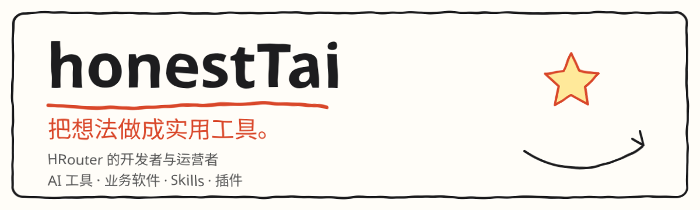

<picture>
  <source media="(prefers-color-scheme: dark)" srcset="assets/hero.zh-CN.svg">
  
</picture>

**你好，我是 honestTai，HRouter 的开发者与运营者。** 把日常需求做成能直接运行的工具。

[HRouter](https://hrouter.net/home) · [下载桌面客户端](https://github.com/honestTai/HRouter-Desktop/releases/latest) · [全部仓库](https://github.com/honestTai?tab=repositories) · [联系我](mailto:honesttibo@mail.grokbot.com)

[English](README.md) · **简体中文**

## 🚀 从这里开始

<table>
<tr>
<td width="50%" valign="top">

### [HRouter Desktop](https://github.com/honestTai/HRouter-Desktop)
**少配置，多写代码。**

本地优先的桌面工作台，管理 AI 编程工具、供应商、密钥与模型路由。

[下载 macOS / Windows →](https://github.com/honestTai/HRouter-Desktop/releases/latest)

</td>
<td width="50%" valign="top">

### [ZZ Geo](https://github.com/honestTai/geo-console)
**先看证据，再动手优化。**

查看 AI 回答中的品牌提及与来源，审计官网，跟进内容整改。

[体验交互演示 →](https://www.honesttai.com/interactive/preview.html)

</td>
</tr>
<tr>
<td width="50%" valign="top">

### [SeeHTML AI](https://github.com/honestTai/seehtml-ai)
**一个想法 → HTML → 演示文稿或视频。**

在本地用 AI 创作并预览 HTML，导出 PPTX、图片或 MP4。

[了解创作流程 →](https://github.com/honestTai/seehtml-ai)

</td>
<td width="50%" valign="top">

### [motion-library](https://github.com/honestTai/motion-library)
**给视频开发用的动效库。**

152 张配方卡、209 条样片、Remotion 源码和 agent skill。

[浏览动效库 →](https://github.com/honestTai/motion-library)

</td>
</tr>
</table>

## 🛡️ 上游开源贡献

独立发现并修复 [Wei-Shaw/sub2api](https://github.com/Wei-Shaw/sub2api) 的 EasyPay 支付回调伪造漏洞（Critical），已合并并随 **v0.2.14** 发布：[Issue #7881](https://github.com/Wei-Shaw/sub2api/issues/7881) · [PR #7888](https://github.com/Wei-Shaw/sub2api/pull/7888) · [Release Notes](https://github.com/Wei-Shaw/sub2api/releases/tag/v0.2.14)

## 📈 Star 历史

<a href="https://www.star-history.com/#honestTai/geo-console&honestTai/hrouter-market-pulse&honestTai/HRouter-Desktop&Date">
  <picture>
    <source media="(prefers-color-scheme: dark)" srcset="https://api.star-history.com/svg?repos=honestTai/geo-console%2ChonestTai/hrouter-market-pulse%2ChonestTai/HRouter-Desktop&type=Date&theme=dark">
    
  </picture>
</a>

图表由 star-history.com 绘制。完整的仓库清单与趋势见[数据目录](data/README.md)。

---

Made by **honestTai** · [HRouter](https://hrouter.net/home) · [Email](mailto:honesttibo@mail.grokbot.com)

**找到喜欢的项目，试一试；遇到问题，欢迎提 Issue。**

